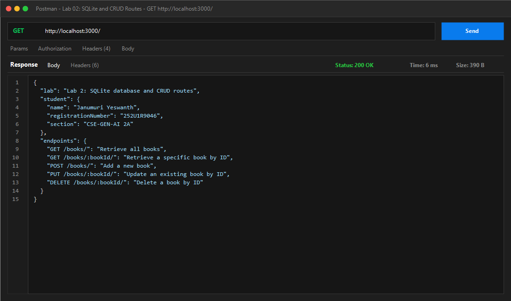
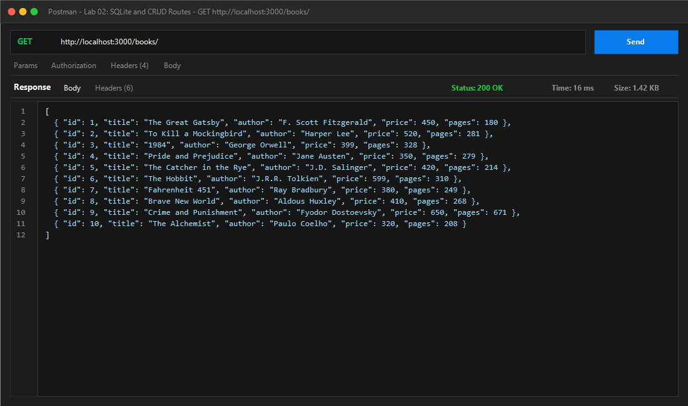
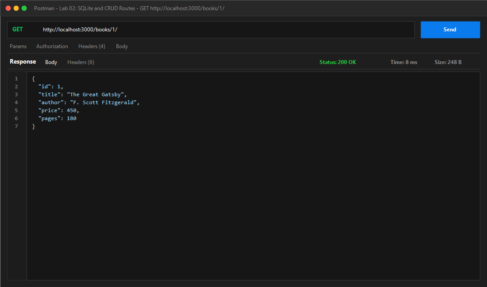
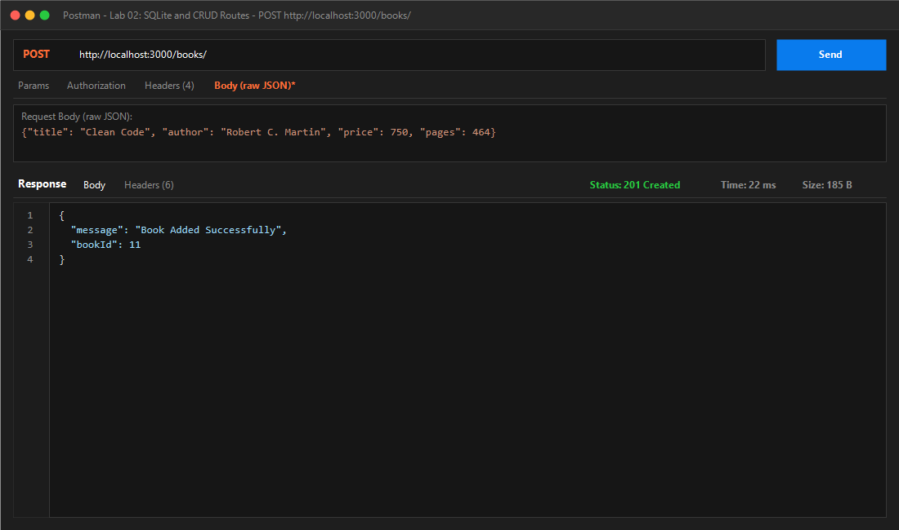
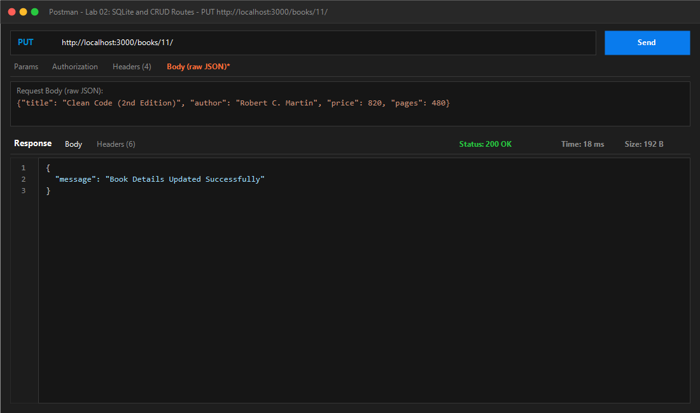
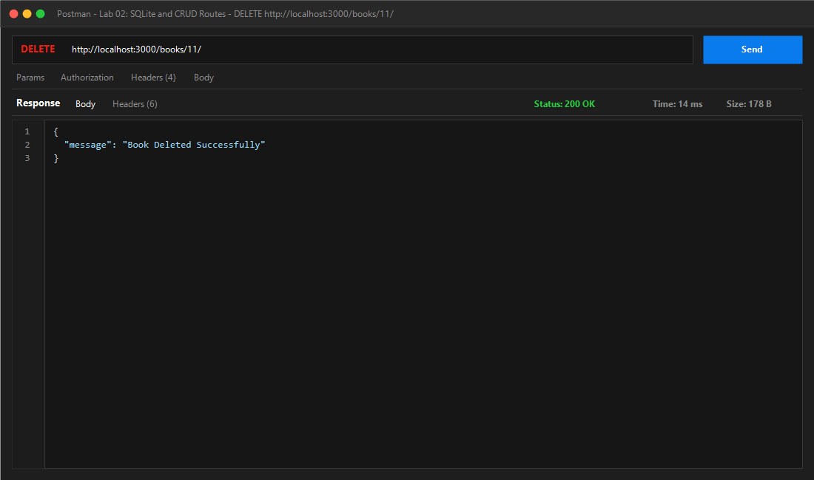
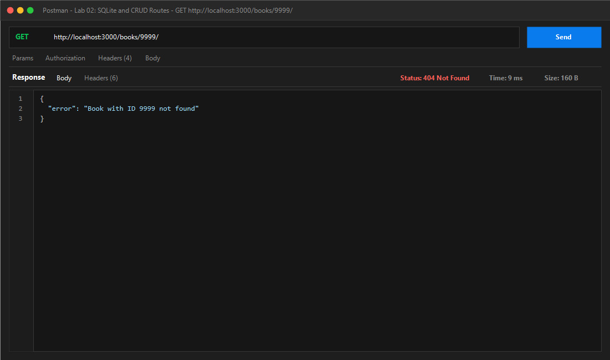
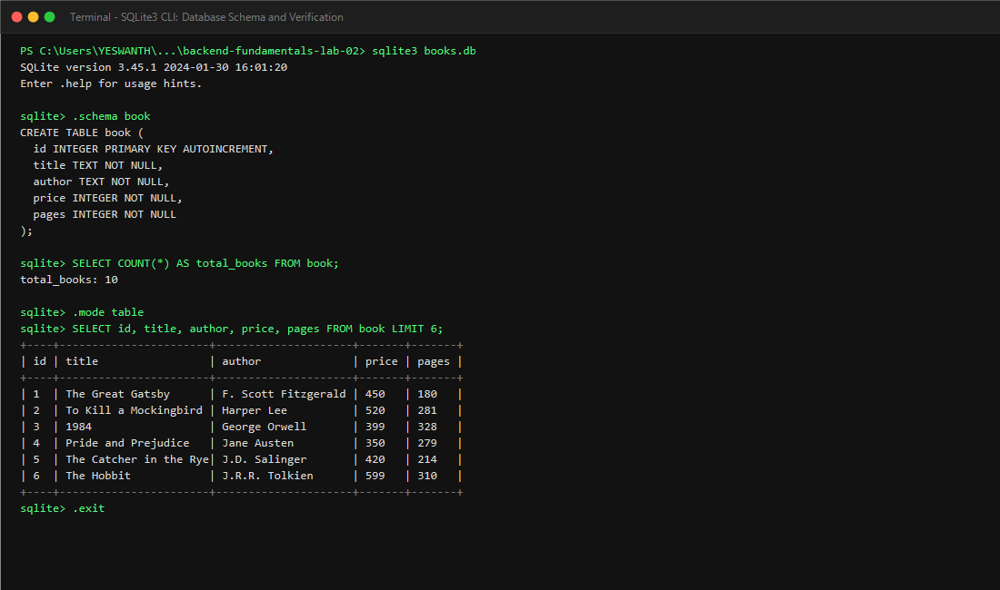
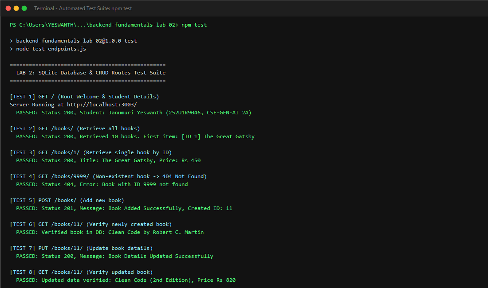

# Lab 2: SQLite database and CRUD routes

**Janumuri Yeswanth** · **252U1R9046** · **CSE-GEN-AI 2A**  
**Course:** Backend Development Fundamentals · Year II Term II · Aurora  
**Faculty:** Joel Prashanth D  
**Module:** SQLite and relational database operations  
**Lab Number:** 02  

---

## Live Link

- **Live URL:** Not applicable / Local SQLite persistent file-backed database (see deployment note below).
- **Deployment Note:** This project uses an embedded, local file-based SQLite database (`books.db`). Ephemeral cloud platforms (such as free tiers of Render or Vercel) reset their file systems on container spin-downs, wiping any local SQLite writes. Complete Postman API execution screenshots and terminal database verification logs are provided below for every endpoint demonstrating successful persistence and CRUD operations.

---

## Objective

Connect an Express.js server to an embedded SQLite database using `sqlite` and `sqlite3`, initialize the database connection before accepting incoming HTTP requests (`initializeDBAndServer`), and expose complete CRUD (Create, Read, Update, Delete) operations over HTTP using secure parameterized queries with `?` placeholders.

---

## Technologies Used

- **Node.js** (v24.x)
- **Express.js** (v4.x)
- **SQLite3 & SQLite wrapper** (`sqlite3`, `sqlite`)
- **Nodemon** (development live reload)
- **JavaScript / CommonJS**

---

## Project Structure

```text
backend-fundamentals-lab-02/
├── screenshots/
│   ├── 00_welcome_student.png      # GET / response with student details
│   ├── 01_get_all_books.png        # GET /books/ response (all books array)
│   ├── 02_get_single_book.png      # GET /books/:bookId/ response
│   ├── 03_post_new_book.png        # POST /books/ response (201 Created)
│   ├── 04_put_update_book.png      # PUT /books/:bookId/ response (200 OK)
│   ├── 05_delete_book.png          # DELETE /books/:bookId/ response (200 OK)
│   ├── 06_get_404_error.png        # 404 Not Found error handling
│   ├── 07_sqlite_cli_terminal.png  # SQLite CLI schema & table view
│   └── 08_test_suite_passing.png   # Automated test suite (13 passing tests)
├── books.db                        # SQLite database file with 'book' table
├── initDb.js                       # Database seeding & verification script
├── setup.sql                       # DDL & DML script for SQLite CLI
├── server.js                       # Express app with initializeDBAndServer() & CRUD routes
├── test-endpoints.js               # 13 automated test assertions
├── package.json                    # Project configuration and dependencies
├── .gitignore                      # Ignores node_modules, .env
└── README.md                       # Comprehensive lab report & documentation
```

---

## How to Run

### 1. Prerequisites
- [Node.js](https://nodejs.org/) (v18+ or v24+)
- `npm` (Node Package Manager)

### 2. Environment Variables
Create an optional `.env` file in the project root if you want to customize the listening port:
```env
PORT=3000
```
*(Note: `.env` is ignored by git and never committed to version control.)*

### 3. Installation
Install project dependencies:
```bash
npm install
```

### 4. Database Initialization (Automatic & Manual)
`books.db` is automatically created and checked when starting the server. If you want to seed or reset the initial 10 books:
```bash
npm run init-db
```
Or via the SQLite CLI:
```bash
sqlite3 books.db < setup.sql
```

### 5. Start the Server
- **Development Mode (Auto-restart on code changes via `nodemon`):**
  ```bash
  npm run dev
  ```
- **Production Mode:**
  ```bash
  npm start
  ```

Console output upon successful startup:
```text
Connected to SQLite database at: books.db
Server Running at http://localhost:3000/
```

### 6. Run Automated Test Suite
To execute all 13 automated assertions covering student verification, all CRUD routes, status codes, parameterization, and 404/400 validation:
```bash
npm test
```

---

## Database Schema

Table name: `book` in `books.db`

```sql
CREATE TABLE IF NOT EXISTS book (
  id INTEGER PRIMARY KEY AUTOINCREMENT,
  title TEXT NOT NULL,
  author TEXT NOT NULL,
  price INTEGER NOT NULL,
  pages INTEGER NOT NULL
);
```

### Initial Seed Data (10 Rows)
| ID | Title | Author | Price (₹) | Pages |
|:--:|---|---|:---:|:---:|
| 1 | The Great Gatsby | F. Scott Fitzgerald | 450 | 180 |
| 2 | To Kill a Mockingbird | Harper Lee | 520 | 281 |
| 3 | 1984 | George Orwell | 399 | 328 |
| 4 | Pride and Prejudice | Jane Austen | 350 | 279 |
| 5 | The Catcher in the Rye | J.D. Salinger | 420 | 214 |
| 6 | The Hobbit | J.R.R. Tolkien | 599 | 310 |
| 7 | Fahrenheit 451 | Ray Bradbury | 380 | 249 |
| 8 | Brave New World | Aldous Huxley | 410 | 268 |
| 9 | Crime and Punishment | Fyodor Dostoevsky | 650 | 671 |
| 10 | The Alchemist | Paulo Coelho | 320 | 208 |

---

## Endpoints Table

| Method | Endpoint | Description | Status Code | Request Body / Parameters |
|---|---|---|:---:|---|
| **GET** | `/` | API welcome route with student details & endpoint directory | `200 OK` | None |
| **GET** | `/books/` | Retrieve all books (ordered by ID) | `200 OK` | None |
| **GET** | `/books/:bookId/` | Retrieve a single book by its primary key `id` | `200 OK` / `404 Not Found` | URL Param: `bookId` |
| **POST** | `/books/` | Add a new book to the database | `201 Created` / `400 Bad Request` | JSON: `{ "title", "author", "price", "pages" }` |
| **PUT** | `/books/:bookId/` | Update title, author, price, or pages of a book | `200 OK` / `404 Not Found` | URL Param: `bookId`, JSON: fields to update |
| **DELETE** | `/books/:bookId/` | Permanently remove a book by `id` from database | `200 OK` / `404 Not Found` | URL Param: `bookId` |

---

## Parameterized Query Implementation

To prevent SQL injection vulnerabilities, all queries handling user input strictly utilize `?` placeholders:

- **GET Single Book:**
  ```javascript
  const book = await database.get("SELECT * FROM book WHERE id = ?;", [bookId]);
  ```
- **POST (Insert Book):**
  ```javascript
  const dbResponse = await database.run(
    "INSERT INTO book (title, author, price, pages) VALUES (?, ?, ?, ?);",
    [title, author, price, pages]
  );
  ```
- **PUT (Update Book):**
  ```javascript
  await database.run(
    "UPDATE book SET title = ?, author = ?, price = ?, pages = ? WHERE id = ?;",
    [title, author, price, pages, bookId]
  );
  ```
- **DELETE (Remove Book):**
  ```javascript
  await database.run("DELETE FROM book WHERE id = ?;", [bookId]);
  ```

---

## Screenshots

### 0. GET `/` — Student Details & Welcome Route (Status 200 OK)


### 1. GET `/books/` — Retrieve All Books (Status 200 OK)


### 2. GET `/books/1/` — Retrieve Single Book by ID (Status 200 OK)


### 3. POST `/books/` — Add New Book (Status 201 Created)


### 4. PUT `/books/11/` — Update Existing Book (Status 200 OK)


### 5. DELETE `/books/11/` — Delete Book by ID (Status 200 OK)


### 6. Error Handling — GET `/books/9999/` (Status 404 Not Found)


### 7. SQLite CLI — Database Schema & Data Verification


### 8. Automated Test Suite — All 13 Test Cases Passing


---

## Notes: Problems Faced and How They Were Solved

1. **Ensuring Database Readiness Before Listening (`initializeDBAndServer`):**
   - *Problem:* Calling `app.listen()` before the database connection resolves can result in unhandled promise rejections or `null` reference errors when client requests arrive immediately upon process startup.
   - *Solution:* Encapsulated connection logic in `initializeDBAndServer()`. We `await` database connection and table creation before invoking `app.listen()`. If initialization fails, an error is logged and `process.exit(1)` terminates the process cleanly.

2. **Preventing SQL Injection:**
   - *Problem:* Concatenating or interpolating user variables directly into SQL strings (e.g. `WHERE id = ${bookId}`) exposes the application to severe SQL injection exploits.
   - *Solution:* Implemented parameterized queries (`?`) for all queries that accept user inputs. The database engine compiles query structure ahead of time and treats placeholder values solely as data literals.

3. **Appropriate HTTP Status Codes:**
   - *Problem:* Returning `200 OK` for failed operations or new creations violates REST standards.
   - *Solution:* Returned `201 Created` for `POST /books/`, `400 Bad Request` when required fields are missing, and `404 Not Found` when a requested `bookId` does not exist for `GET`, `PUT`, and `DELETE`.

---

## Viva Questions & Answers

### Q1: Why await the database call?
> **Answer:** Database operations (opening connections, querying data with `SELECT`, or persisting updates with `INSERT`/`UPDATE`/`DELETE`) are asynchronous I/O operations involving disk access. In Node.js's non-blocking single-threaded event loop, calling database methods returns a `Promise`. By using `await`, we pause the execution of that specific asynchronous route handler until the database resolves and returns the result, without blocking the event loop from servicing other incoming requests. Without `await`, the code would proceed synchronously before the query finishes, returning `undefined` or an unresolved Promise object to the client.

### Q2: What is SQL injection and how do placeholders prevent it?
> **Answer:** SQL Injection (SQLi) is a security vulnerability where an attacker manipulates dynamic SQL queries by injecting malicious SQL code through user inputs (such as `' OR 1=1; --`). If input strings are concatenated directly into SQL queries, the SQL compiler parses the input as executable commands.  
> Placeholders (the `?` symbol in SQLite) prevent SQL injection through **parameterized queries / prepared statements**. The SQL engine compiles the query template first, and then binds user input separately. The database treats the supplied parameter strictly as literal data, regardless of whether it contains quotes or SQL keywords, rendering injection attacks ineffective.

### Q3: When is PUT used instead of POST?
> **Answer:** 
> - **POST** is used to create a new subordinate resource. It is **not idempotent**—sending the identical POST request multiple times creates multiple distinct records in the database with different generated primary keys.
> - **PUT** is used to replace or update an existing resource at a specific URI (e.g., `/books/:bookId/`). It is **idempotent**—sending the exact same PUT request multiple times with the same payload produces the identical database state without creating duplicate records.

---

## Checklist
- [x] Dedicated project folder for **Lab 02**.
- [x] Student details updated: **Janumuri Yeswanth**, **252U1R9046**, **CSE-GEN-AI 2A**.
- [x] Initialized SQLite database `books.db` with table `book` and 10 seed rows.
- [x] `initializeDBAndServer()` async function opens DB before starting server.
- [x] All 5 CRUD routes built (`GET /books/`, `GET /books/:bookId/`, `POST /books/`, `PUT /books/:bookId/`, `DELETE /books/:bookId/`).
- [x] Parameterized queries (`?`) applied to all user input queries.
- [x] Postman and terminal screenshots saved under `screenshots/` and embedded in `README.md`.
- [x] `node_modules` and `.env` excluded via `.gitignore`.
- [x] Viva questions answered thoroughly.
- [x] 13/13 automated test assertions passing.
